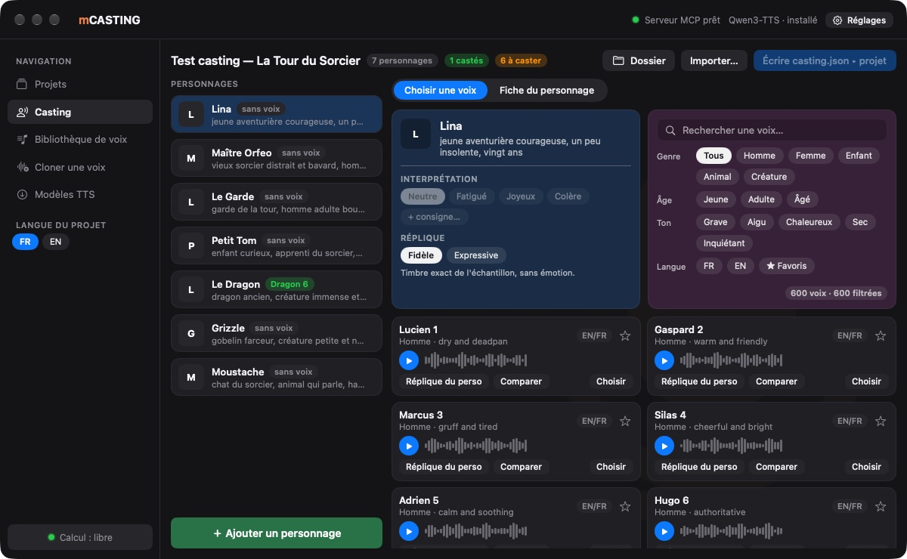
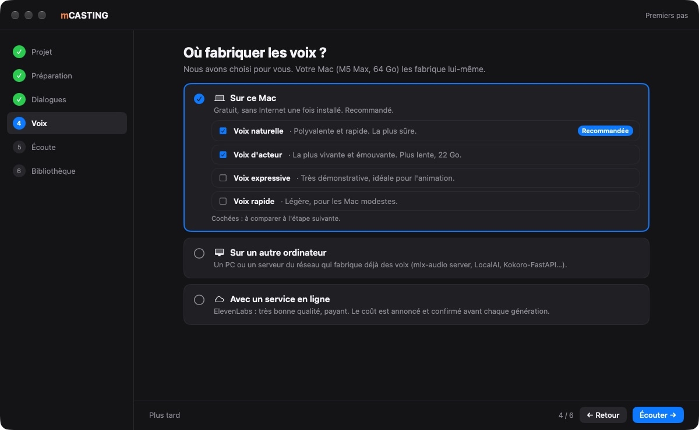
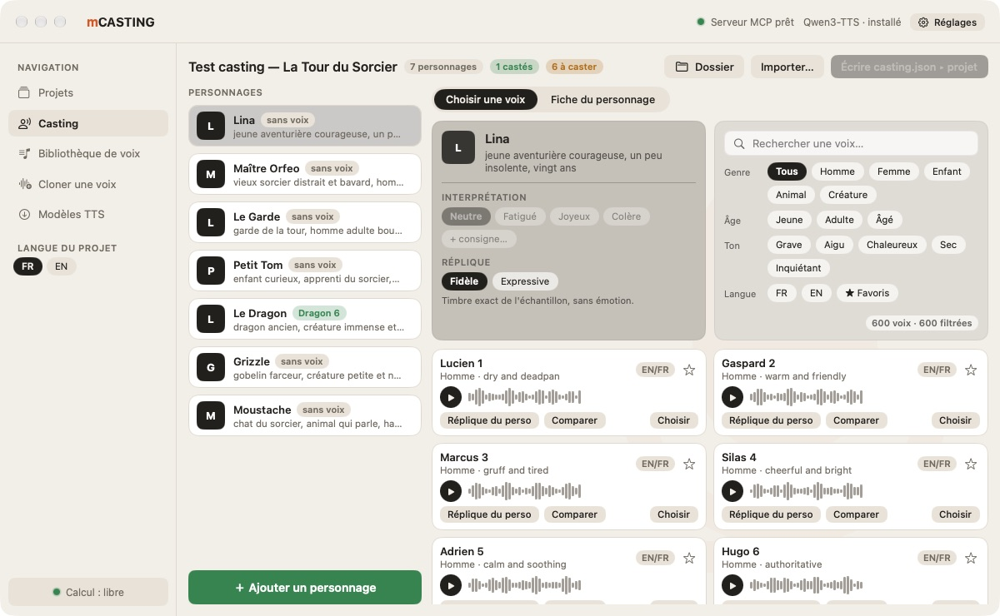
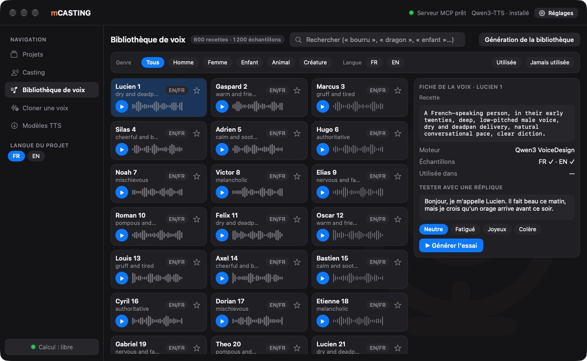

# mCASTING — Documentation

*Version 1.6.4 · DESKTOP MAC TOOLKIT · Starbudweiser & Claude Code (Anthropic) · MIT License*

mCASTING is a macOS app for **casting local AI voices**. For any project that needs voices (game, video, voice-over, tutorial, trailer, audiobook), you describe the characters, listen to a library of about 600 voices, pick one voice per character by ear, then hand the result to an AI agent or a generation script as a `casting.json` file.

Related documents:
- [Development guide (PDF)](../pdf/mCASTING-development-EN.pdf): architecture, data, formats, MCP, build.
- [User interface guide (PDF)](../pdf/mCASTING-interface-EN.pdf): design, colours, components, screens.
- [Import format for agents](../IMPORT.md).



---

## Contents

1. [Installation](#1-installation)
2. [First launch: the Getting started guide](#2-first-launch-the-getting-started-guide)
3. [Projects](#3-projects)
4. [Casting a project](#4-casting-a-project)
5. [Voice library](#5-voice-library)
6. [Cloning a voice](#6-cloning-a-voice)
7. [Voice models](#7-voice-models)
8. [Creatures and animals](#8-creatures-and-animals)
9. [Working with an AI assistant](#9-working-with-an-ai-assistant)
10. [Voices made elsewhere: network server and ElevenLabs](#10-voices-made-elsewhere-network-server-and-elevenlabs)
11. [The casting.json file](#11-the-castingjson-file)
12. [MCP server](#12-mcp-server)
13. [Settings and updates](#13-settings-and-updates)
14. [Data, privacy and rights](#14-data-privacy-and-rights)
15. [FAQ and troubleshooting](#15-faq-and-troubleshooting)

---

## 1. Installation

**Requirements:** a Mac with Apple silicon (M1 or later), macOS 15 or later. Leave disk space for the models (3 to 30 GB depending on your choices) and the library (about 1 GB).

1. Download the latest version from the GitHub releases page: `github.com/starbudweiser/mCASTING/releases`.
2. Unzip it and move `mCASTING.app` to your Applications folder.
3. Open the app. It is signed and notarized by Apple.

When first needed, mCASTING installs its own speech engine in its data folder: an isolated Python environment with mlx-audio. Nothing is installed system-wide and no account is required.

## 2. First launch: the Getting started guide

At launch, an animated splash shows for three seconds, then the main window opens. On first launch, and for every new project, the **Getting started** guide walks you through. It asks one question per screen, with the recommended choice already selected. "Later" is always available, and the guide stays reachable from the menu bar icon (*Getting started…*).

| Step | What you do |
|---|---|
| **1. Project** | Give a name, choose the folder where `casting.json` will be written and the voice language (French or English). |
| **2. Preparation** | Choose whether an AI prepares your project: the AI you already use (Claude, ChatGPT, Cursor…), an AI installed on your Mac (Ollama, LM Studio), or none. |
| **3. Dialogue** | Drop your lines: an mCASTING project file (JSON), a CSV table (`character; line; language`) or text (`NAME: line`). |
| **4. Voices** | Choose where voices are made: on this Mac (models fit to your hardware), on another computer on your network, or with an online service (ElevenLabs). |
| **5. Listening** | The checked models speak the same lines from your project; you pick the one that will voice your characters. |
| **Creatures** | (Only if your project has some.) Suggested voices, voice effects and generated cries. |
| **6. Library** | mCASTING builds the 600 voices in the background; you can cast in the meantime. |



**AI assistant or voice model?** They are two different roles. The *AI assistant* works on text: it reads your project and describes the characters. The *voice model* makes the audio. You can use one without the other.

## 3. Projects

The **Projects** page shows one card per project: number of characters, number of cast characters, a progress bar and the state of the `casting.json` file.

- **New project** opens the guide on the steps that matter.
- **Import a project…** loads a JSON file in the `mcasting-project/1` format.
- Click a card to open the project in Casting.
- A card's **trash** icon removes the project from mCASTING after confirmation. Its folder and its `casting.json` are left untouched.

## 4. Casting a project



1. **Pick a character** in the left column. "Add a character" creates a new one.
2. In the **Choose a voice** tab, the character panel recalls the role, the current voice if any, and the delivery.
3. **Filter** the library on the right: free search, gender, age, tone, language, favourites.
4. On each voice card:
   - ▶ plays the voice's sample;
   - **Character line** has this voice speak one of your character's lines;
   - **Compare** starts A/B listening against another voice;
   - **Choose** assigns the voice to the character;
   - the star adds it to your favourites.
5. **Faithful or Expressive**:
   - *Faithful* keeps the sample's exact timbre, without emotion;
   - *Expressive* applies the chosen delivery (neutral, tired, happy, angry, or a free direction).
6. When the casting is done, click **Write casting.json**: the file is created in the project folder.

The **Character sheet** tab lets you edit the name, role, notes and sample lines, try each line, and set the default delivery.

Tip: right-click the character list (or select several characters) to assign random voices, which is handy for a first pass.

**Native accent:** when a project is in English, lines are spoken from the voice's English sample, with a native accent. A voice chosen in French keeps the same timbre in English, without a French accent.

## 5. Voice library



The library holds **600 recipes** (men, women, children, animals, creatures), each with a French and an English sample. They are made on your Mac by the Qwen3-TTS VoiceDesign model.

- Free search ("gruff", "dragon", "child"…) and filters: gender, language, used or never used voices.
- The voice card shows its recipe (its description), engine, samples and the projects using it. You can also try it on a free sentence with an emotion.
- **Library generation** starts or resumes the build. One job runs at a time, and its status shows at the bottom of the sidebar.

## 6. Cloning a voice

1. Open **Clone a voice**.
2. Pick an audio or video file (WAV, MP3, M4A, AIFF…) or paste a web link (YouTube and other sites, audio only).
3. Select a 5 to 15 second excerpt where the voice is clear and alone.
4. Check the automatic transcript and fix it if needed.
5. Tick the box certifying you have the right to use this voice, then add it: it joins the library like any other voice.

> Only use voices you have the right to use: your own, someone who gave consent, or a royalty-free voice.

## 7. Voice models

The **TTS models** page shows the local engine and each model, with its state (installed, downloading) and size. Models are downloaded from Hugging Face on demand, and a download resumes if it is interrupted.

| Name in the guide | Model | Size | Strength |
|---|---|---|---|
| Voice creator | Qwen3-TTS VoiceDesign | 3.1 GB | Builds the library from descriptions. |
| Natural voice | Qwen3-TTS Base | 3.1 GB | Versatile and fast, recommended by default. |
| Actor voice | Fish Audio Drama 3 | 22 GB | The most lively and moving, slower. |
| Expressive voice | Chatterbox multilingual | 2.7 GB | Very demonstrative, ideal for animation. |
| Fast voice | OmniVoice | 1.3 GB | Light, for smaller Macs. |
| Sound effects | Stable Audio 3 Small SFX | 3.5 GB | Creature and animal cries. |

The guide only offers models that suit your Mac. A model is recommended when it needs less than half of the memory, and it is no longer shown above 70%.

## 8. Creatures and animals

A character marked "creature" or "animal" (by the import, by the AI, or from its name and role) gets dedicated tools:

- **Suggested voices**: three library voices, chosen from the species (dragon, troll, goblin, ghost, robot, cat…).
- **Voice effects**: three effects to try by ear depending on the kind of creature, for example very deep, growling, cavernous, high, squeaky, ghostly echo, metallic or radio. The chosen effect applies to line trials.
- **Cry**: a wordless sound effect generated by the sound-effects model, to replay or redo.

The effect is written to `casting.json` with its ffmpeg equivalent (`fx_ffmpeg`), so the final lines sound like what you chose.

## 9. Working with an AI assistant

### With the AI you already use

At the guide's *Preparation* step, **Install in my AIs** detects Claude Code, Codex (ChatGPT), Cursor and Claude Desktop, then adds:
- the **mcasting skill**, instructions that teach the agent how to structure a project for voice casting;
- the **mcasting MCP server**, which lets the agent drive the app.

Every settings file is backed up before it is changed, and nothing happens without your confirmation. **Copy the instructions for my AI** gives you the same guide to paste into any other AI.

Then simply ask your agent: *"Import this project into mCASTING."* It reads your files (script, dialogue, game files), builds the character list and imports it. You cast by ear in the app, then the agent generates the lines from `casting.json`.

### With an AI installed on your Mac

If **Ollama** or **LM Studio** runs on your Mac, mCASTING detects it. It can then analyse your characters (gender, age, human, creature or animal, and a voice description), for free and without sending anything online. An existing casting is never changed.

## 10. Voices made elsewhere: network server and ElevenLabs

### On another computer

If a computer on your network runs an OpenAI-compatible voice server (mlx-audio server, LocalAI, Kokoro-FastAPI…):
1. At the guide's *Voices* step, choose **On another computer**, enter its address (for example `http://pc-studio.local:8000`) and a key if the server needs one.
2. Click **Test**.
3. Choose between **Create the library on this server** (if the server can create voices from a description) and **Import this model's voices** (ready-made voices, with a French and an English sample).

*Faithful* mode (cloning) stays on your Mac, because these servers do not receive audio excerpts.

### With ElevenLabs (paid)

1. Choose **With an online service**, enter your ElevenLabs key (kept in the Keychain) and click **Check**: your credit balance appears.
2. **Import my ElevenLabs voices** is free: only the preview samples are downloaded.
3. Every generation with an ElevenLabs voice first shows the character count and the estimated credits (about 0.4 credit per character), and waits for your confirmation.

## 11. The casting.json file

`casting.json` is written in the project folder. For each character it gives:

- the chosen voice (`voice_id`), its recipe and the delivery (`style`);
- one voice sample per language (`samples`) and the model that speaks the lines (`acting_model`);
- for a cloned voice, the reference excerpt and text (`ref_audio`, `ref_text`);
- the lines in other languages (`lines_alt`);
- for a creature, the cry (`sfx`) and the effect (`fx`, `fx_ffmpeg`);
- for a server or ElevenLabs voice, the remote model and voice.

**Generation rule:** each line is spoken by cloning the voice's sample *in the line's language* with the acting model. Never regenerate a voice from its description: the model would draw a new timbre every time. The full format is in the [development guide](../pdf/mCASTING-development-EN.pdf).

## 12. MCP server

mCASTING includes an MCP server (`mcasting-mcp`). The exact command to declare it in your agent is shown in **Settings › MCP server**, for example:

```bash
claude mcp add mcasting -- "/Applications/mCASTING.app/Contents/MacOS/mcasting-mcp"
```

Tools: `get_import_guide`, `import_project`, `export_project`, `list_projects`, `create_project`, `add_characters`, `list_characters`, `search_voices`, `set_casting`, `preview_voice`, `write_casting`. Incoming calls are listed in the Settings log.

## 13. Settings and updates

- **General**: interface language (French, English, Spanish, Italian; automatic by default) and library folder.
- **Updates**: mCASTING checks for a new version every day. With "Install automatically" on, it installs it and relaunches, never during a job. A button runs the check by hand.
- **MCP server**: command to copy, list of tools, call log.
- The window always opens centred, at the last size you gave it.

## 14. Data, privacy and rights

- Everything is stored on your Mac, in `~/Library/Application Support/mCASTING/`: projects, library, audio samples, engine and models.
- Nothing is sent online except what you trigger: model downloads from Hugging Face, a web link to clone, the voice server you chose, and ElevenLabs if you use it.
- Keys (server, ElevenLabs) are kept in the macOS Keychain, never in files.
- You are responsible for the rights to the voices you clone or import. Some models have their own license: Fish Audio Drama 3, for example, requires attribution for commercial use.

## 15. FAQ and troubleshooting

**Generation is slow.** One job runs at a time, and the first trial of a model loads it into memory. Pick a lighter model (Fast voice) on a smaller Mac.

**A model is missing from the guide.** It needs too much memory for your Mac (over 70%). The TTS models page lists them all.

**An English voice has a French accent.** Check that the project language is English (sidebar, *Project language*): lines are then spoken from the English sample.

**My agent doesn't see mCASTING.** Run *Preparation › Install in my AIs* again, or declare the server with the command from Settings, then restart the agent.

**Where is casting.json written?** In the folder chosen for the project (*Folder* button on the Casting screen). Without a folder, *Write casting.json* is disabled.

**Does deleting a project erase my files?** No. The project leaves mCASTING, but its folder and its `casting.json` stay in place.
