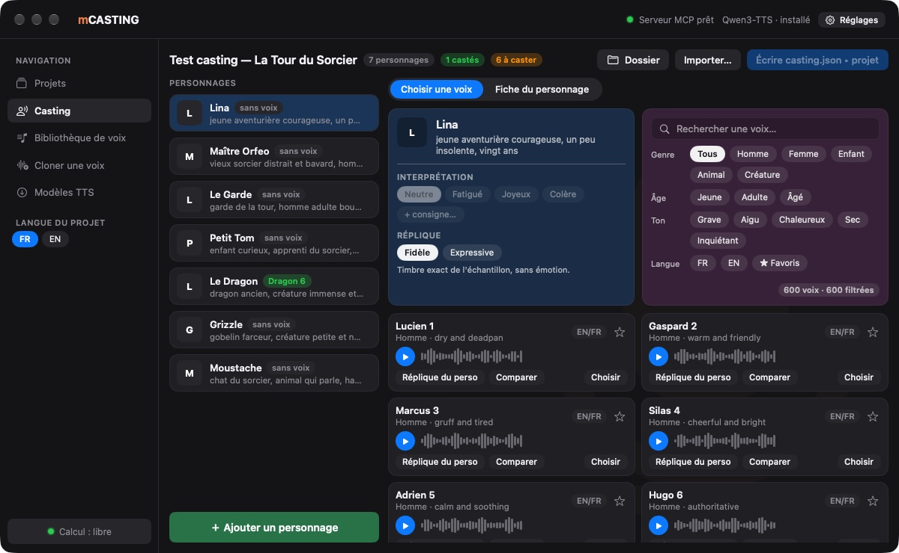
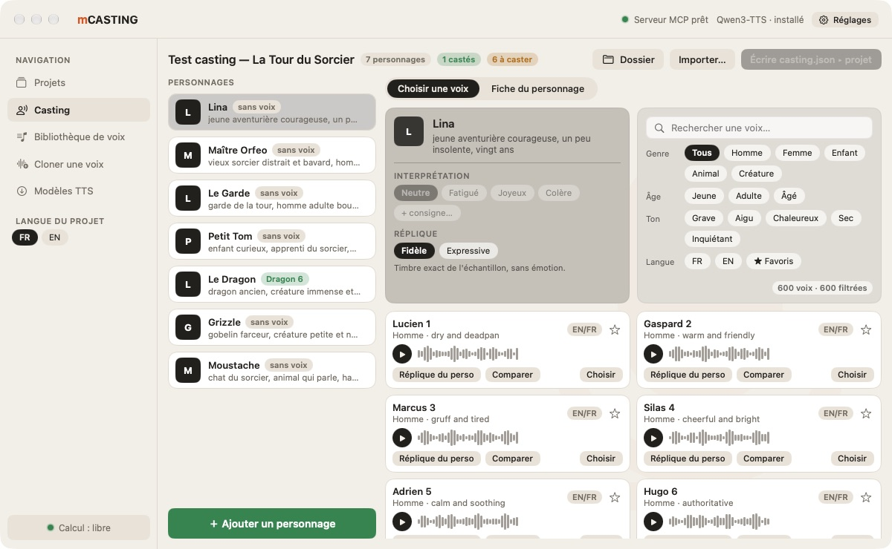
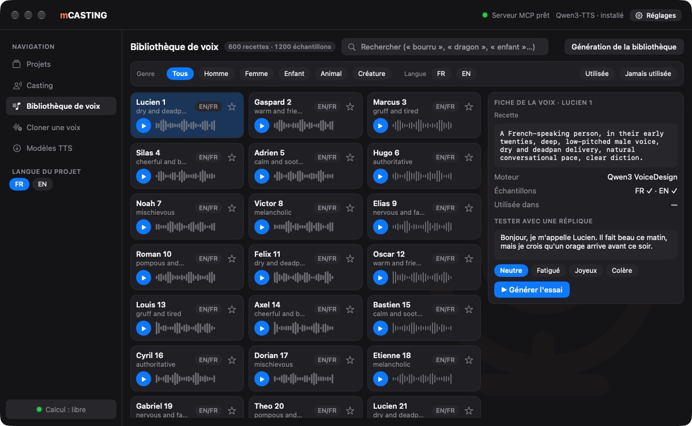

# mCASTING — Documentation

*Version 1.6.4 · DESKTOP MAC TOOLKIT · Starbudweiser & Claude Code (Anthropic) · Licence MIT*

mCASTING est une application macOS de **casting de voix IA locales**. Pour tout projet qui a besoin de voix (jeu, vidéo, voix off, tutoriel, bande-annonce, livre audio), vous décrivez les personnages, vous écoutez une bibliothèque d'environ 600 voix, vous choisissez une voix par personnage à l'oreille, puis vous transmettez le résultat à un agent IA ou à un script de génération sous la forme d'un fichier `casting.json`.

Documents associés :
- [Dossier de développement (PDF)](../pdf/mCASTING-developpement-FR.pdf) : architecture, données, formats, MCP, compilation.
- [Interface graphique (PDF)](../pdf/mCASTING-interface-FR.pdf) : design, couleurs, composants, écrans.
- [Format d'import pour les agents](../IMPORT.md).



---

## Sommaire

1. [Installation](#1-installation)
2. [Premier lancement : le guide « Premiers pas »](#2-premier-lancement--le-guide--premiers-pas-)
3. [Projets](#3-projets)
4. [Casting d'un projet](#4-casting-dun-projet)
5. [Bibliothèque de voix](#5-bibliothèque-de-voix)
6. [Cloner une voix](#6-cloner-une-voix)
7. [Modèles de voix](#7-modèles-de-voix)
8. [Créatures et animaux](#8-créatures-et-animaux)
9. [Travailler avec un assistant IA](#9-travailler-avec-un-assistant-ia)
10. [Voix fabriquées ailleurs : serveur réseau et ElevenLabs](#10-voix-fabriquées-ailleurs--serveur-réseau-et-elevenlabs)
11. [Le fichier casting.json](#11-le-fichier-castingjson)
12. [Serveur MCP](#12-serveur-mcp)
13. [Réglages et mises à jour](#13-réglages-et-mises-à-jour)
14. [Données, confidentialité et droits](#14-données-confidentialité-et-droits)
15. [Questions fréquentes et dépannage](#15-questions-fréquentes-et-dépannage)

---

## 1. Installation

**Configuration requise :** Mac à puce Apple (M1 ou plus récent), macOS 15 ou plus récent. Prévoyez de l'espace disque pour les modèles (3 à 30 Go selon vos choix) et la bibliothèque (environ 1 Go).

1. Téléchargez la dernière version sur la page des releases GitHub : `github.com/starbudweiser/mCASTING/releases`.
2. Décompressez le zip et placez `mCASTING.app` dans votre dossier Applications.
3. Ouvrez l'application. Elle est signée et notarisée par Apple.

Au premier besoin, mCASTING installe son propre moteur de synthèse dans son dossier de données : un environnement Python isolé avec mlx-audio. Rien n'est installé dans le système, et aucun compte n'est demandé.

## 2. Premier lancement : le guide « Premiers pas »

Au lancement, un splash animé s'affiche trois secondes, puis la fenêtre principale s'ouvre. Au premier lancement, et à chaque nouveau projet, le guide **Premiers pas** vous accompagne. Une question par écran, le choix conseillé déjà sélectionné ; « Plus tard » est toujours possible, et le guide reste accessible par le menu de l'icône (*Premiers pas…*).

| Étape | Ce que vous faites |
|---|---|
| **1. Projet** | Donnez un nom, choisissez le dossier où `casting.json` sera écrit et la langue des voix (français ou anglais). |
| **2. Préparation** | Choisissez si une IA prépare votre projet : l'IA que vous utilisez déjà (Claude, ChatGPT, Cursor…), une IA installée sur votre Mac (Ollama, LM Studio), ou aucune. |
| **3. Dialogues** | Déposez vos répliques : fichier de projet mCASTING (JSON), tableau CSV (`personnage ; réplique ; langue`) ou texte (`NOM : réplique`). |
| **4. Voix** | Choisissez où fabriquer les voix : sur ce Mac (modèles adaptés à votre matériel), sur un autre ordinateur du réseau, ou avec un service en ligne (ElevenLabs). |
| **5. Écoute** | Les modèles cochés disent les mêmes répliques de votre projet ; vous choisissez celui qui jouera vos personnages. |
| **Créatures** | (Seulement si votre projet en a.) Voix suggérées, effets de voix et cris générés. |
| **6. Bibliothèque** | mCASTING fabrique les 600 voix en arrière-plan ; vous pouvez caster pendant ce temps. |


**Assistant IA ou modèle de voix ?** Ce sont deux rôles différents. L'*assistant IA* travaille sur du texte : il lit votre projet et décrit les personnages. Le *modèle de voix* fabrique l'audio. Vous pouvez utiliser l'un sans l'autre.

## 3. Projets

La page **Projets** affiche une carte par projet : nombre de personnages, nombre de personnages castés, barre d'avancement et état du fichier `casting.json`.

- **Nouveau projet** ouvre le guide sur les étapes utiles.
- **Importer un projet…** charge un fichier JSON au format `mcasting-project/1`.
- Cliquez sur une carte pour ouvrir le projet dans Casting.
- La **corbeille** d'une carte retire le projet de mCASTING après confirmation. Son dossier et son fichier `casting.json` ne sont pas touchés.

## 4. Casting d'un projet



1. **Choisissez un personnage** dans la colonne de gauche. « Ajouter un personnage » en crée un nouveau.
2. Dans l'onglet **Choisir une voix**, le panneau du personnage rappelle son rôle, sa voix actuelle s'il en a une, et l'interprétation.
3. **Filtrez** la bibliothèque à droite : recherche libre, genre, âge, ton, langue, favoris.
4. Sur chaque carte de voix :
   - ▶ écoute l'extrait de la voix ;
   - **Réplique du perso** fait dire une réplique de votre personnage par cette voix ;
   - **Comparer** lance une écoute A/B avec une autre voix ;
   - **Choisir** attribue la voix au personnage ;
   - l'étoile la met dans vos favoris.
5. **Fidèle ou Expressive** :
   - *Fidèle* garde le timbre exact de l'extrait, sans émotion ;
   - *Expressive* applique l'interprétation choisie (neutre, fatigué, joyeux, colère, ou une consigne libre).
6. Quand le casting est fait, cliquez sur **Écrire casting.json** : le fichier est créé dans le dossier du projet.

L'onglet **Fiche du personnage** permet de modifier le nom, le rôle, les notes et les répliques d'exemple, d'essayer chaque réplique, et de régler l'interprétation par défaut.

Astuce : un clic droit sur la liste des personnages (ou une sélection multiple) attribue des voix aléatoires, ce qui est pratique pour un premier jet.

**Accent natif :** quand un projet est en anglais, les répliques sont dites à partir de l'extrait anglais de la voix, avec un accent natif. Une voix choisie en français garde donc le même timbre en anglais, sans accent français.

## 5. Bibliothèque de voix



La bibliothèque compte **600 recettes** (hommes, femmes, enfants, animaux, créatures), chacune avec un extrait en français et un extrait en anglais. Elles sont fabriquées sur votre Mac par le modèle Qwen3-TTS VoiceDesign.

- Recherche libre (« bourru », « dragon », « enfant »…) et filtres : genre, langue, voix utilisées ou jamais utilisées.
- La fiche de la voix affiche sa recette (sa description), son moteur, ses extraits, les projets qui l'utilisent, et permet un essai sur une phrase libre avec une émotion.
- **Génération de la bibliothèque** lance ou reprend la fabrication. Un seul calcul tourne à la fois, et son état s'affiche en bas de la barre latérale.

## 6. Cloner une voix

1. Ouvrez **Cloner une voix**.
2. Choisissez un fichier audio ou vidéo (WAV, MP3, M4A, AIFF…) ou collez un lien web (YouTube et d'autres sites, audio seul).
3. Sélectionnez un extrait de 5 à 15 secondes, où la voix est claire et seule.
4. Vérifiez la transcription automatique, et corrigez-la si besoin.
5. Cochez la case par laquelle vous certifiez avoir le droit d'utiliser cette voix, puis ajoutez-la : elle rejoint la bibliothèque comme une voix normale.

> N'utilisez que des voix dont vous avez le droit : la vôtre, celle d'une personne qui a donné son accord, ou une voix libre de droits.

## 7. Modèles de voix

La page **Modèles TTS** affiche le moteur local et chaque modèle, avec son état (installé, en téléchargement) et sa taille. Les modèles sont téléchargés depuis Hugging Face à la demande, avec reprise en cas de coupure.

| Nom dans le guide | Modèle | Taille | Point fort |
|---|---|---|---|
| Créateur de voix | Qwen3-TTS VoiceDesign | 3,1 Go | Fabrique la bibliothèque à partir des descriptions. |
| Voix naturelle | Qwen3-TTS Base | 3,1 Go | Polyvalente et rapide, conseillée par défaut. |
| Voix d'acteur | Fish Audio Drama 3 | 22 Go | La plus vivante et émouvante, plus lente. |
| Voix expressive | Chatterbox multilingue | 2,7 Go | Très démonstrative, idéale pour l'animation. |
| Voix rapide | OmniVoice | 1,3 Go | Légère, pour les Mac modestes. |
| Bruitages | Stable Audio 3 Small SFX | 3,5 Go | Cris de créatures et d'animaux. |

Le guide ne propose que les modèles adaptés à votre Mac : un modèle est conseillé s'il utilise moins de la moitié de la mémoire, et il n'est plus affiché au-delà de 70 %.

## 8. Créatures et animaux

Un personnage marqué « créature » ou « animal » (par l'import, par l'IA, ou d'après son nom et son rôle) a droit à des outils dédiés :

- **Voix suggérées** : trois voix de la bibliothèque, choisies selon l'espèce (dragon, troll, gobelin, fantôme, robot, chat…).
- **Effets de voix** : trois effets à essayer à l'oreille selon le type de créature, par exemple très grave, grondant, caverneux, aigu, couinant, écho spectral, métallique ou radio. L'effet choisi s'applique aux essais de répliques.
- **Cri** : un bruitage sans paroles, généré par le modèle de bruitages, à rejouer ou à refaire.

L'effet est inscrit dans `casting.json` avec son équivalent ffmpeg (`fx_ffmpeg`), pour que les répliques définitives sonnent comme ce que vous avez choisi.

## 9. Travailler avec un assistant IA

### Avec l'IA que vous utilisez déjà

À l'étape *Préparation* du guide, **Installer dans mes IA** détecte Claude Code, Codex (ChatGPT), Cursor et Claude Desktop, puis y ajoute :
- le **skill mcasting**, des instructions qui apprennent à l'agent à structurer un projet pour un casting voix ;
- le **serveur MCP mcasting**, qui permet à l'agent de piloter l'appli.

Chaque fichier de configuration est sauvegardé avant modification, et rien n'est fait sans votre confirmation. **Copier les instructions pour mon IA** fournit le même mode d'emploi à coller dans n'importe quelle autre IA.

Demandez ensuite simplement à votre agent : *« Importe ce projet dans mCASTING. »* Il lit vos fichiers (script, dialogues, fichiers du jeu), construit la liste des personnages et l'importe. Vous castez à l'oreille dans l'appli, puis l'agent génère les répliques à partir de `casting.json`.

### Avec une IA installée sur votre Mac

Si **Ollama** ou **LM Studio** tourne sur votre Mac, mCASTING le détecte. Il peut alors analyser vos personnages (genre, âge, humain, créature ou animal, et une description de la voix), gratuitement et sans rien envoyer sur Internet. Le casting déjà fait n'est jamais modifié.

## 10. Voix fabriquées ailleurs : serveur réseau et ElevenLabs

### Sur un autre ordinateur

Si un ordinateur de votre réseau fait tourner un serveur de voix compatible OpenAI (mlx-audio server, LocalAI, Kokoro-FastAPI…) :
1. À l'étape *Voix* du guide, choisissez **Sur un autre ordinateur**, saisissez son adresse (par exemple `http://pc-studio.local:8000`) et une clé si le serveur en demande une.
2. Cliquez sur **Tester**.
3. Choisissez entre **Créer la bibliothèque sur ce serveur** (si le serveur sait créer des voix à partir d'une description) et **Importer les voix de ce modèle** (voix toutes prêtes, avec un extrait FR et EN).

Le mode *Fidèle* (clonage) reste fait sur votre Mac, car ces serveurs ne reçoivent pas d'extraits audio.

### Avec ElevenLabs (payant)

1. Choisissez **Avec un service en ligne**, saisissez votre clé ElevenLabs (rangée dans le Trousseau) et cliquez sur **Vérifier** : le solde de crédits s'affiche.
2. **Importer mes voix ElevenLabs** est gratuit : seuls les extraits de présentation sont téléchargés.
3. Chaque génération avec une voix ElevenLabs affiche d'abord le nombre de caractères et les crédits estimés (environ 0,4 crédit par caractère), et attend votre confirmation.

## 11. Le fichier casting.json

`casting.json` est écrit dans le dossier du projet. Pour chaque personnage, il indique :

- la voix choisie (`voice_id`), sa recette, l'interprétation (`style`) ;
- un extrait de la voix par langue (`samples`) et le modèle qui dit les répliques (`acting_model`) ;
- pour une voix clonée, l'extrait et le texte de référence (`ref_audio`, `ref_text`) ;
- les répliques dans les autres langues (`lines_alt`) ;
- pour une créature, le cri (`sfx`) et l'effet (`fx`, `fx_ffmpeg`) ;
- pour une voix de serveur ou d'ElevenLabs, le modèle et la voix distante.

**Règle de génération :** chaque réplique est dite en clonant l'extrait de la voix *dans la langue de la réplique* avec le modèle de jeu. On ne régénère jamais une voix depuis sa description, car le modèle tirerait un nouveau timbre à chaque fois. Le détail du format est dans le [dossier de développement](../pdf/mCASTING-developpement-FR.pdf).

## 12. Serveur MCP

mCASTING contient un serveur MCP (`mcasting-mcp`). La commande exacte pour le déclarer dans votre agent est affichée dans **Réglages › Serveur MCP**, par exemple :

```bash
claude mcp add mcasting -- "/Applications/mCASTING.app/Contents/MacOS/mcasting-mcp"
```

Outils : `get_import_guide`, `import_project`, `export_project`, `list_projects`, `create_project`, `add_characters`, `list_characters`, `search_voices`, `set_casting`, `preview_voice`, `write_casting`. Les appels reçus s'affichent dans le journal des Réglages.

## 13. Réglages et mises à jour

- **Général** : langue de l'interface (français, anglais, espagnol, italien ; automatique par défaut) et dossier de la bibliothèque.
- **Mises à jour** : mCASTING vérifie chaque jour s'il existe une nouvelle version. Avec « Installer automatiquement », il l'installe et se relance, jamais pendant un calcul. Un bouton lance la recherche à la main.
- **Serveur MCP** : commande à copier, liste des outils, journal des appels.
- La fenêtre s'ouvre toujours centrée, à la dernière taille que vous lui avez donnée.

## 14. Données, confidentialité et droits

- Tout est stocké sur votre Mac, dans `~/Library/Application Support/mCASTING/` : projets, bibliothèque, extraits audio, moteur et modèles.
- Rien n'est envoyé sur Internet, sauf ce que vous déclenchez : téléchargement des modèles depuis Hugging Face, lien web à cloner, serveur de voix que vous avez choisi, ElevenLabs si vous l'utilisez.
- Les clés (serveur, ElevenLabs) sont rangées dans le Trousseau macOS, jamais dans des fichiers.
- Vous êtes responsable des droits sur les voix que vous clonez ou importez. Certains modèles ont leur propre licence : Fish Audio Drama 3, par exemple, demande une mention en cas d'usage commercial.

## 15. Questions fréquentes et dépannage

**La génération est lente.** Un seul calcul tourne à la fois, et le premier essai d'un modèle le charge en mémoire. Choisissez un modèle plus léger (Voix rapide) sur un Mac modeste.

**Un modèle n'apparaît pas dans le guide.** Il demande trop de mémoire pour votre Mac (plus de 70 %). La page Modèles TTS les liste tous.

**Une voix anglaise a un accent français.** Vérifiez que la langue du projet est bien l'anglais (barre latérale, *Langue du projet*) : les répliques sont alors dites à partir de l'extrait anglais.

**Mon agent ne voit pas mCASTING.** Relancez l'étape *Préparation › Installer dans mes IA*, ou déclarez le serveur avec la commande des Réglages, puis redémarrez l'agent.

**Où est écrit casting.json ?** Dans le dossier choisi pour le projet (bouton *Dossier* de l'écran Casting). Sans dossier, le bouton *Écrire casting.json* est désactivé.

**Supprimer un projet efface-t-il mes fichiers ?** Non. Le projet disparaît de mCASTING, mais son dossier et son `casting.json` restent en place.
